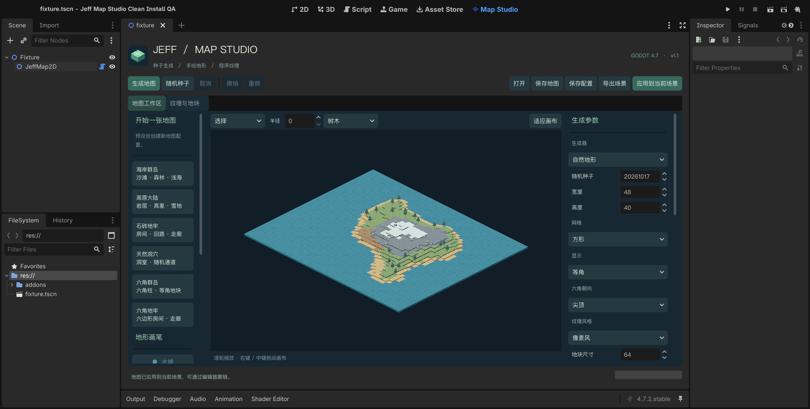

# Jeff Map Studio

**[成品画廊与在线试做](https://jeffstudio-dev.github.io/jeff-map-studio/)** · Godot 4.7.2 的地图生成与制作插件。支持自然地形、地牢、洞穴，方形／六角网格，俯视／等角显示，2.5D 高低地块，手绘与区域锁定，以及程序化纹理和图集绑定。

## 开始使用

1. 用 Godot 4.7.2 打开本目录的 `project.godot`。
2. 在编辑器顶部选择 **Map Studio**。插件已在此演示工程启用。
3. 选择左侧预设，或调整右侧参数后点击 **生成地图**。
4. 使用画笔修改、锁定区域，再保存地图、导出场景，或应用到当前编辑场景。

按 **F5** 运行独立工作区演示。打开 `demo/runtime_demo.tscn` 后按 **F6** 查看运行时 API 示例。

- [完整使用说明与 API](addons/jeff_map_studio/README.md)
- [GitHub 参考与素材来源](addons/jeff_map_studio/docs/REFERENCES.md)
- [架构与维护说明](addons/jeff_map_studio/docs/ARCHITECTURE.md)
- [测试说明](tests/README.md)
- [首版验收与性能记录](addons/jeff_map_studio/docs/VALIDATION.md)
- [手绘／像素风格与标志物（当前本地版）](addons/jeff_map_studio/docs/STYLES.md)
- [1.1 可拼接地块：厚度、侧面材质与单块预览](addons/jeff_map_studio/docs/BLOCKS.md)

安装到其他工程时，仅复制 `addons/jeff_map_studio`，然后在 **项目设置 → 插件** 启用。也可以直接用 Godot 打开本仓库作为演示工程。

当前主分支包含双风格地块、标志物和规范驱动的像素草地，尚未发布安装包；本地验收后会在 Releases 中提供插件 ZIP 和演示工程 ZIP。

代码、图标和程序化示例素材采用 MIT 许可。高度为视觉效果，首版不包含角色寻路或多层桥洞。



## 网站与网页版

`docs/` 是 GitHub Pages 网站：成品地图画廊、地块与物品参考图，以及浏览器里运行的 Map Studio（`docs/play/`）。全部在后台生成，不打开窗口：

```sh
godot --headless --path . --script tools/render_site_gallery.gd   # 渲染地图、地块、物品
python3 tools/build_site.py                                       # 整理为 docs/gallery
python3 tools/build_web.py --godot /path/to/godot                 # 导出网页版到 docs/play
```

网页版是单线程构建：生成和烘焙在主线程运行（`MapWork`），默认 64×64 地图，并只在网页上使用随附的 GNU Unifont（OFL 1.1，见 `demo/fonts/`）显示中文。若未安装与编辑器同版本的导出模板，可用 `--template` 指定 `web_nothreads_release.zip`。
