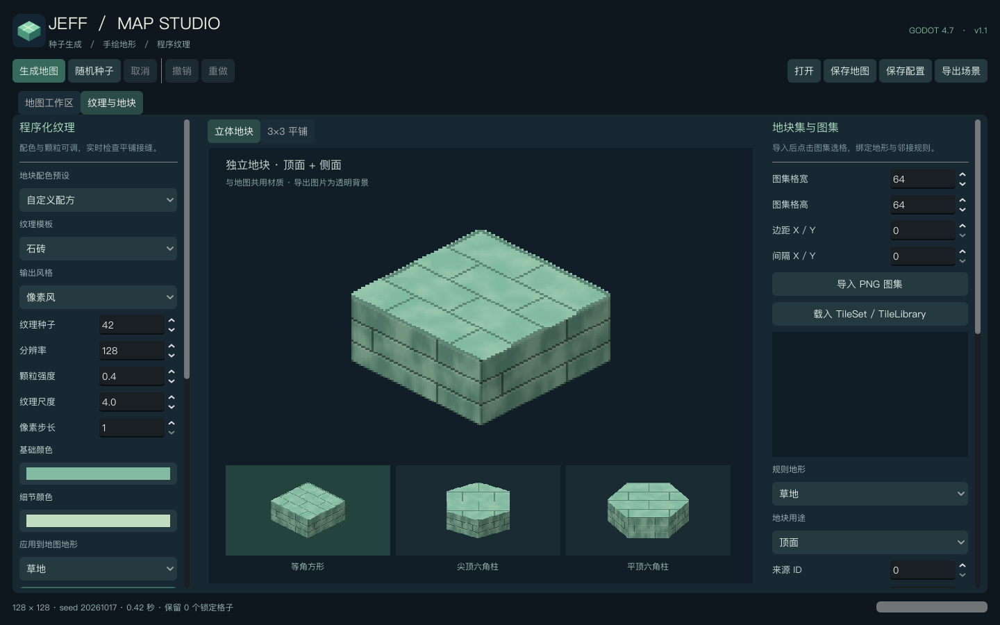

# 1.1 可拼接地块

本轮按照参考图的厚地块方向，增加独立底座、程序化侧面材质和单块预览。地图仍由可拼接的顶面、侧面和装饰层组成；单块 PNG 用于查看或导出完整外观。

最新双风格与标志物说明见 [STYLES.md](STYLES.md)。以下保留此前材质细化及测试记录。

## 此前本地材质细化（未打包）

2026-10-17 继续按参考图优化了四套材质，方形、尖顶六角和平顶六角共用同一套绘制逻辑：

- 草块增加有投影的草簇、小碎石和明暗叶尖；侧面以不规则苔藓、根须和裸露土层替换规则噪声条带。
- 砖块增加逐块色差、细砖缝、受光倒角、磨损角及局部裂缝；侧面使用错缝砖层。
- 水面增加稀疏弧形波纹和浅色水线；侧面区分浅水、中层和深蓝底层。
- 沙地增加砂砾、短风纹；侧面使用起伏的沉积层、细夹层及底部暗层。

更新后的 12 张透明示例位于 `examples/blocks/`，本轮示例按 256 的地块尺寸绘制，实际图片尺寸随形状变化并包含透明边距。工作区预览、运行时图集和 PNG 导出均使用新材质；地图布局数据不变。程序纹理和已绑定图集示例也已同步重新生成。

本轮全程 `--headless`，774 项检查通过；截图和真实图形接缝检查未执行。此处和聊天展示的单块图像来自后台 Image 栅格化导出，不需要打开 Godot 窗口。`dist/` 中的旧 ZIP 未修改，当前细化结果尚未打包，等待用户完成本地测试。

## 使用

1. 打开 **Map Studio → 纹理与地块**。
2. 选择苔藓草块、青玉砖块、浅海水柱或分层沙土预设。
3. 在中央的 **立体地块** 页点击下方卡片，切换等角方形、尖顶六角柱、平顶六角柱；**3×3 平铺** 页继续检查顶面纹理。
4. 左侧向下滚动，调整底座厚度、侧面纹理、细节强度和两种侧面颜色。厚度会同步到地图显示配置；材质改动通过 **应用纹理到地图** 应用。
5. 点击 **导出当前地块 PNG**，输出当前形状的透明图片；保存配方可在之后继续修改。

以下为前一轮工作区截图，界面位置仍适用；最新材质请查看 `examples/blocks/`。



## 厚度与拼接

| 参数或行为 | 说明 |
|---|---|
| 底座厚度 | 0–64 的偶数像素，向高度 0 的平面下方延伸；0 关闭底座 |
| 格子高度 | 继续使用 0–16 的整数层，与底座厚度分别保存 |
| 新建默认值 | 工作区和内置地图预设使用 16 像素；旧配置缺少字段时保持 0 |
| 遮挡 | 地图边界及空洞绘制可见底座，相邻实心格子之间隐藏底座侧面 |
| 俯视显示 | 隐藏底座；切回等角恢复，不改动地形、高度、装饰、手绘和锁定数据 |
| 选格 | 支持顶面、高度侧面及底座侧面，包括窄格子与高柱 |

底座也使用原生 `TileMapLayer`，与高度侧面共用排序方式。场景烘焙包含底座层及对应图集，仍可脱离插件运行。外部 TileSet 的侧面绑定继续用于高度侧面；新增底座使用内置程序材质。整块 PNG 不直接替代自动遮挡所需的分层图集。

## 材质与示例

侧面提供随材质、土层、苔藓、岩层、砖墙、水层六个选项。顶面与侧面分开配色，侧面包含方向明暗、纹理细节和底部分层。顶面、侧面和预览共用绘制代码与种子；等角方形顶面按平面坐标取样，砖缝随投影方向排列。

`examples/blocks/` 包含四份 `.tres` 配方及 12 张透明 PNG：

- `moss`：苔藓草块。
- `jade_brick`：青玉砖块。
- `lagoon`：浅海水柱。
- `sandstone`：分层沙土。

每套均提供 `square`、`hex_pointy`、`hex_flat` 三种形状。导出尺寸随纹理分辨率变化，块体宽度取 16–256 的偶数值，并保留透明边距；透明背景是真实 Alpha。侧面颜色、样式及厚度纳入图集缓存标识，修改后会重新绘制。

这些素材由插件程序生成，随插件以 MIT 许可发布。用户参考图仅用于理解外观方向，未复制进发布包；当前本地版已另外生成灯塔、棕榈树等两套标志物，见 [STYLES.md](STYLES.md)；未使用参考图中的角色。

## 验证记录

2026-10-17，Godot `4.7.2.stable.steam.ed1daf0bf`，macOS / Apple M4。本轮完整测试通过 **820 项检查**，无失败：核心 481、素材 123、工作区 70、运行时演示 10、接缝 36、地块 87、干净工程编辑器 12、保存场景运行 1。

新增 87 项覆盖三种形状的底座、选格、内部遮挡、擦除邻居更新、厚度变化不改结构、资源回读、12 个示例的确定性与透明度、侧面缓存刷新、实际工作区预览和 PNG 导出、非法配方保留旧结果。还覆盖 16 像素窄格子、32 像素层高及 0／1／16 层柱体的侧面选格。

上述完整结果和截图来自此前的图形测试。用户要求后台测试后，默认入口已统一为 `--headless`；不会再自动打开窗口或切换焦点。后台测试跳过截图与接缝像素检查，不能将跳过项记作通过。有窗口的视觉验收需要用户明确要求。

随后使用默认后台入口复验，**774 项检查全部通过**：核心 481、素材 123、工作区 60、运行时演示 10、地块 87、干净工程编辑器 12、保存场景运行 1。36 项接缝像素检查及 10 项截图检查未执行。后台保存场景关闭缩略图生成，仍实际验证保存、回读和单独进程运行。

### 512×512 厚地块性能

此前真实图形环境实测，等角自然地图、64 像素格子、16 像素底座、默认 0–8 层高度，六角为尖顶。耗时包含生成、图集准备、铺图和完成后五帧刷新。

| 指标 | 方形 | 六角 |
|---|---:|---:|
| 格子数 | 262,144 | 262,144 |
| 完整耗时 | 5.52 秒 | 12.77 秒 |
| 期间处理帧数 | 391 | 324 |
| 最大采样帧间隔 | 201 ms | 254 ms |
| 引擎静态分配采样峰值 | 190.0 MiB | 273.5 MiB |
| 取消并确认旧地图保留 | 103 ms | 89 ms |

生成期间继续处理帧，但原生 TileMapLayer 刷新仍存在约 0.20–0.25 秒的短暂停顿。内存为 Godot 静态分配采样，不代表进程全部内存或显存；两种地图在同一进程依次测量，包含缓存。取消时间包含随后三帧检查。原始数据见 [blocks-performance.json](blocks-performance.json)。

默认后台复现：

```sh
python3 tools/run_tests.py --godot /absolute/path/to/godot --clean-install
```

历史 1.0 验收和性能保留在 [VALIDATION.md](VALIDATION.md)，完整测试说明见演示工程的 `tests/README.md`。
