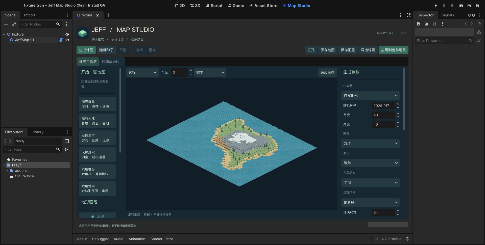
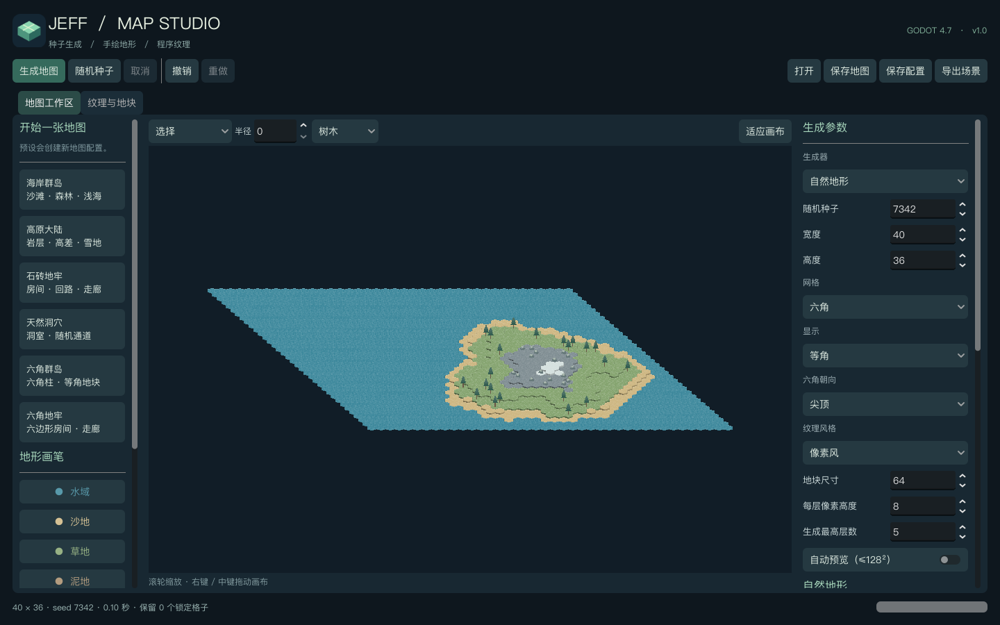
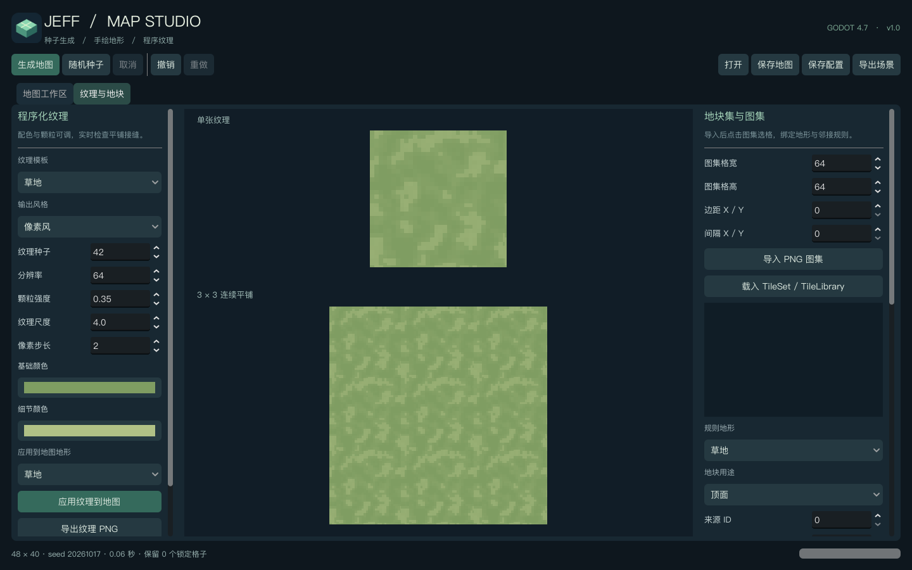

# 首版验收记录

日期：2026-10-17。引擎：Godot **4.7.2.stable.steam.ed1daf0bf**。环境：macOS / Apple M4 / Compatibility（OpenGL 4.1 Metal）。测试使用真实图形环境；其他操作系统尚未实机验证。

## 结果

**733 项自动检查全部通过**，另通过两次 512×512 性能与铺图取消验证。测试执行器同时检查退出码及 Godot 的 `ERROR`、`SCRIPT ERROR`；最终日志无上述错误。

| 测试 | 检查数 | 主要覆盖 |
|---|---:|---|
| 核心 | 481 | 三种生成器的 72 组网格／种子组合、连通性、确定性、独立随机流、坐标转换、锁定、存取、非法参数与纹理重复边界 |
| 素材 | 123 | PNG 切分、原生 Terrain、替代与权重、匹配优先级、缺失规则定位、失败事务、四套已绑定图集示例 |
| 工作区集成 | 70 | 网格／投影矩阵、选格、实际鼠标笔划、撤销重做、风格切换、取消、原生场景烘焙与保存回读 |
| 运行时演示 | 10 | 实际演示场景启动、视角／风格／网格快捷键、保存 |
| 接缝像素检查 | 36 | 方形与六角、两种六角朝向、俯视／等角、像素／平滑、0.28／0.65／1.4 倍缩放 |
| 干净工程编辑器 | 12 | 首次导入、启用插件、@tool 生成、应用到场景、EditorUndoRedo、保存及重载 |
| 干净工程运行时 | 1 | 在独立游戏进程中加载并渲染编辑器保存的场景 |

接缝检查将内置地面设为不透明纯白，检查中心区域是否因拼接产生暗像素。首轮发现分数缩放下的漏像素和平滑过滤黑边；通过蒙版覆盖及透明像素 RGB 扩展修复，并重新生成了发布图集。此检查验证内置模板；导入美术仍需核对自身边缘与绘制原点。

## 512×512 实测

默认自然生成参数、等角显示、默认 0–8 层高度、64 像素地块；六角使用尖顶。每张图 262,144 格。耗时包含后台生成、图集准备、主线程铺图及完成后五帧刷新。

| 指标 | 方形 | 六角 |
|---|---:|---:|
| 完整耗时 | 4.89 秒 | 10.78 秒 |
| 期间处理帧数 | 348 | 283 |
| 最大采样帧间隔 | 202 ms | 255 ms |
| 引擎静态分配采样峰值 | 186.4 MiB | 269.1 MiB |
| 铺图取消后检查旧地图 | 103 ms | 83 ms |

生成和铺图期间持续处理帧，取消后保留上一张完整地图。引擎创建／刷新 TileMapLayer 时仍有约 0.20–0.26 秒的短暂帧间隔峰值；这些数据不表示全程维持 60 FPS。内存为 `OS.get_static_memory_usage()` 的采样峰值，不包括全部进程 RSS 或显存；两种网格在同一进程中依次测试，包含旧地图和缓存的开销。取消耗时包含随后三帧的状态检查。

原始性能数据见 [performance.json](performance.json)。完整工程运行测试后，日志与截图位于 `test_output/`。

## 复现

在完整演示工程根目录执行：

```sh
python3 tools/run_tests.py --godot /absolute/path/to/godot --clean-install
```

以上默认在后台运行，截图与接缝像素检查会明确跳过。本页保留的是此前真实图形环境的历史测量；当前项目日常测试使用 `--headless`，有窗口验收需要用户明确要求。

独立插件包仅包含 `addons/jeff_map_studio`。完整工程包额外提供演示场景、测试与打包脚本。干净工程验证会复制插件到临时项目，不使用当前工程的 `.godot` 缓存。

## 实际截图

Godot 编辑器主工作区：



六角等角地形：



程序纹理与 3×3 平铺预览：



## 已明确的首版边界

- 高度只用于视觉；每格一个顶面，不提供桥洞、多层空间或角色寻路。
- 锁定覆盖会保留人工修改，可能使原本连通的地牢断开；工作区会提示。
- 内置过渡是完整边掩码的材质边缘。任意外部美术需要手工绑定地形语义、边／角规则及原点，不会自动推断材质混合。
- 预览和烘焙默认关闭碰撞与导航；导入 TileSet 的原始属性层保留，游戏可自行接入。
- 烘焙场景移动时需携带同名 `_assets` 目录；生成资源版本与引擎版本变化可能影响未来的随机结果。
