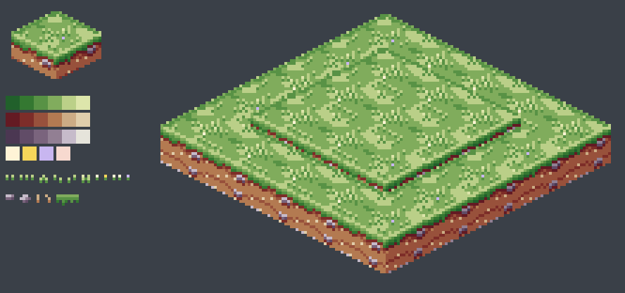
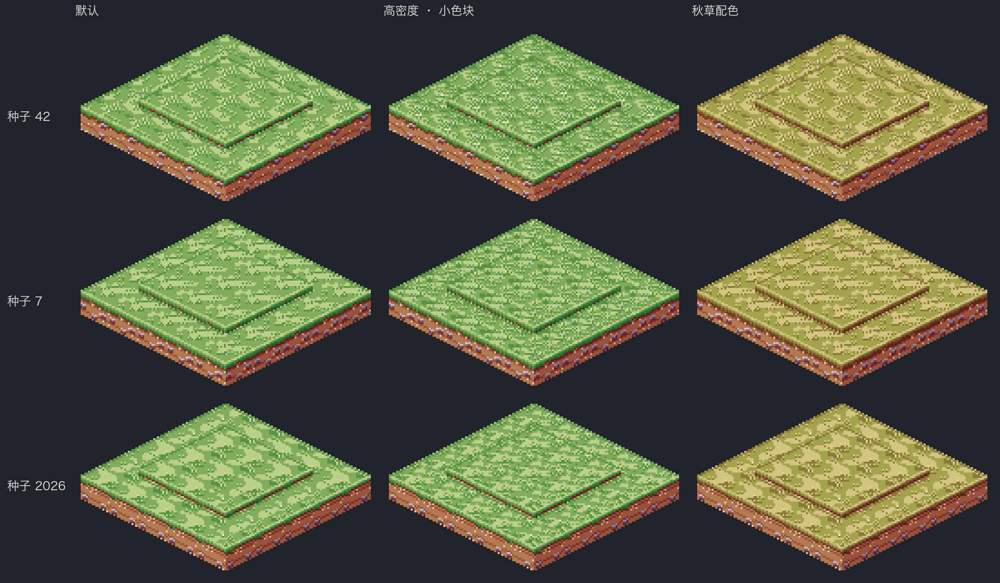
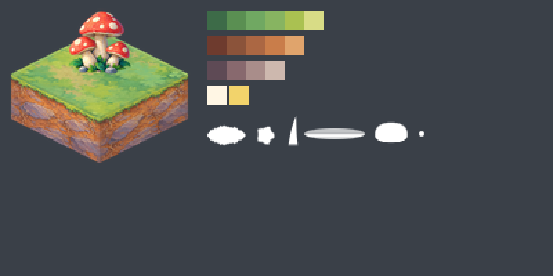
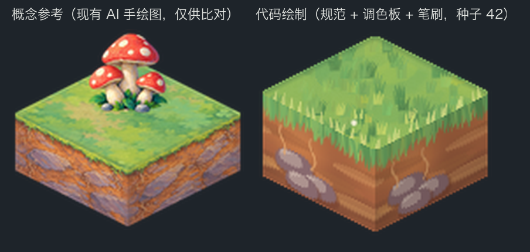
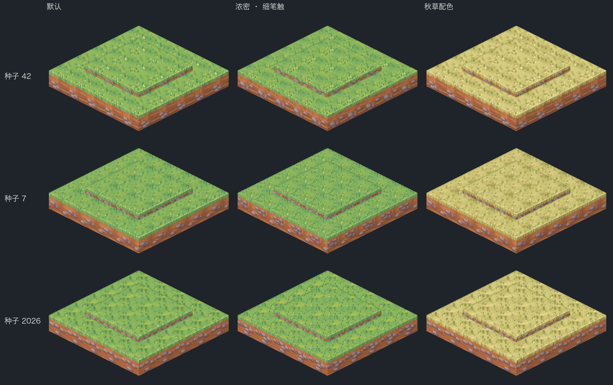

# 程序化地形美术与随机规范 · 设计稿 v0.1（待确认）

> 本目录是设计稿和原型，不属于插件，也不会被 Godot 编辑器导入（含 `.gdignore`）。确认方案后再动插件代码。

> **进度（2026-11-03）**：已按本方案在插件里走通第一种地形——像素风草地（规范 `.tres` + Aseprite 概念图 + 代码绘制，4 种情绪按区域分布 + 格内子变体）。说明见插件文档 `docs/STYLES.md`“规范驱动的地形”。其余地形和手绘风尚未迁移。

## 0. 先回答你的问题

| 问题 | 结论 |
|---|---|
| 两种风格都改成"Aseprite 概念图 + Godot 代码绘制"可行吗？ | 可行。像素风已经是这个结构；手绘风做了原型，草地已能完全由代码画出（见 §1.2）。 |
| 需要先做参考图铺垫吗？ | 需要，但参考图**不再被切成瓦片**，而是提供三样东西：色阶（调色板）、图案／笔刷库、目标样板。前两样由代码读取，样板只用于评审和自动比对。 |
| 需要做各类地形的约束和随机规范文件吗？ | 需要，分两层：**地图生成规则**（哪里长什么地形、相邻约束、物品分布）和**外观规范**（每种地形 × 每种风格怎么画、哪些参数可调、随机范围多大）。 |
| 游戏性能会提升吗？ | 运行时帧率**不会变**：仍是"烘焙图集 + TileMapLayer"，这本来就是最省的显示方式。收益在包体更小（可省约 14 MB 图片）、配色和种子可任意调整。生成大地图慢的主因是铺图（约 1.8 秒），已另提优化任务。 |

## 1. 两个例子（草地）

两个例子用同一个 5×5 布局：中间 3×3 高一层，外圈一层底座。只改种子和参数，所以看到的差异全部来自"随机 + 参数"，不是地图布局。

### 1.1 像素风

| 概念图（Aseprite） | 种子 × 参数 |
|---|---|
|  |  |

- 概念图 `concepts/pixel_grass.aseprite`：参考层（目标样板）、调色板层（`ramp/top`、`ramp/soil`、`ramp/stone`、`accent/*` 切片）、图案层（`motif/tuft/*`、`motif/flower/*`、`motif/cliff_stone/*`、`motif/root/*`、`motif/drip/*`）。
- 规范 `specs/pixel_grass.json`：记录当前像素风代码实际使用的全部参数和随机范围。
- 输出由插件现有代码绘制（`prototype/pixel_examples.gd`）。
- 看得到的问题：图案按"每格一个周期"重复，大面积草地能看出规律感。解决方案见 §6.3。

### 1.2 手绘风

| 概念图（Aseprite） | 概念参考 vs 代码绘制 |
|---|---|
|  |  |



- 概念图 `concepts/painted_grass.aseprite`：参考层是现有 AI 手绘草地块（仅供比对）；调色板是从参考图聚类提取后整理的；笔刷层有 6 个白色带透明度的笔刷（`brush/leaf`、`round`、`flick`、`smear`、`stone`、`dot`）。
- 规范 `specs/painted_grass.json`：分层笔触配方。顶面依次是：晕染底色 → 大块斑驳 → 暗部草丛 → 中间调草丛 → 亮部草尖 → 小花 → 边缘高光；侧面依次是：土层渐变 → 横向土纹 → 石头（三层明暗）→ 根须 → 草沿阴影 → 下垂草叶。
- 原型 `prototype/painted_prototype.gd` 只读规范、调色板和笔刷，没有使用任何现成的地块图片。
- 现状评价：
  - 地图尺度下观感接近手绘、拼接无缝，种子和参数都生效。
  - 单块近看比 AI 参考简单：笔刷是我用脚本生成的占位稿，石头偏平，土层细节少。这是手绘风最大的质量风险，靠美术精修笔刷、增加笔触层来缩小差距（§11）。
  - 耗时：每张 5×5 拼图（2 个顶面变体 + 侧面）约 150 毫秒，GDScript，后台测量。

### 1.3 重新生成例子（全部后台运行，不开窗口）

```sh
aseprite -b --script-param root=$PWD/design --script design/prototype/build_concepts.lua
python3 design/prototype/export_concepts.py /path/to/aseprite
godot --headless --path . --script res://design/prototype/pixel_examples.gd
godot --headless --path . --script res://design/prototype/painted_prototype.gd
python3 design/prototype/contact_sheet.py
```

## 2. 总体流程

```
 Aseprite 概念图（美术维护）        规范文件（美术 / 策划维护）        Godot 代码（程序维护）
 ┌───────────────────────┐
 │ reference 目标样板     │──────────────── 评审、自动比对 ─────────────────────┐
 │ palette   色阶切片     │──导出──┐                                             │
 │ motifs / brushes 图案  │──导出──┤                                             │
 └───────────────────────┘        ▼                                             ▼
                          概念资源 .res ─┐                                  自动校验
            外观规范 .tres（每地形×风格）─┼─▶ 绘制器（种子 + 用户参数）─▶ 图集 ─▶ TileMapLayer ─▶ 渲染
            地图生成规则 .tres ─▶ 地图生成器（地图种子 + 参数）─▶ MapData ──┘
```

- 概念图只在美术修改后导出一次（Aseprite `-b` 批处理），运行时不依赖 Aseprite。
- 绘制在生成或换风格时进行，放在工作线程里，结果烘焙成图集。游戏每帧只是采样图集，与现在一样。

## 3. 参数与随机模型（三层）

| 层级 | 谁来定 | 存放位置 | 例子 | 会被种子随机吗 |
|---|---|---|---|---|
| 风格规范（锁定） | 美术 | `specs/<风格>/<地形>.tres` | 光照方向、色阶步数、笔刷与图案库、笔触层顺序、边缘规则、各参数的**允许范围** | 否，它定义范围 |
| 用户参数（可调） | 插件使用者 | `TextureRecipe`、`MapProfile`（界面） | 主色、亮部色、细节密度、色块尺度、笔触大小、像素步长、侧面细节 | 否，界面按规范范围限制 |
| 种子随机 | 种子 | `seed_value` | 色块形状、草簇与石头位置、笔触角度与大小、变体内容 | 是，只在规范范围内取值 |

- **两个种子，互不影响**：
  - 地图种子（`MapProfile.seed_value`）决定地形布局、高度、物品位置。
  - 美术种子（每种地形的 `TextureRecipe.seed_value`）决定外观。
  - 换风格或改配色，不会改动地图本身（现在已经如此，会保留下来）。
- **独立随机流**：每种用途各用一条随机流（色块、共享笔触、变体笔触、边缘、侧面、过渡）。调"细节密度"只改变笔触数量，不会把色块形状也打乱。生成器里已有的 `random_at(seed, cell, salt)` 就是这种模式。
- **确定性保证**：同一（规范版本 + 用户参数 + 种子）一定得到逐字节相同的图。规范的 `version` 写进图集缓存键，规范一改就会重新烘焙。

## 4. 概念图规范（Aseprite）

### 4.1 文件组织

```
concepts/
  pixel/
    _shared.aseprite        # 通用图案：草簇、卵石、波光、光照方向示意
    grass.aseprite          # 草地（泥地复用沙地并换色，见下表）
    sand.aseprite  water.aseprite  rock.aseprite  brick.aseprite
  painted/
    _shared.aseprite        # 通用笔刷：叶、圆、草叶、拖笔、石头、点
    grass.aseprite ...
```

| 游戏地形 | 用哪份概念图 | 说明 |
|---|---|---|
| 草地 | grass | |
| 沙地、泥地 | sand | 泥地 = 沙地规范 + 另一组色阶 |
| 水域 | water | 侧面是水深渐变 |
| 岩石、雪地 | rock | 雪地 = 岩石规范的"柔和"分支 |
| 地板、墙体 | brick | 墙体用深色色阶 |

每种风格 5 份地形概念图 + 1 份通用库，共 12 份。

### 4.2 图层与命名约定（两个例子已按此制作）

| 图层 | 代码是否读取 | 内容 |
|---|---|---|
| `reference` | 否 | 目标样板：单块、3×3 拼接、带高差。用于评审，以及自动比对颜色分布 |
| `palette` | 是 | 切片 `ramp/<名称>`（色块从暗到亮排列）、`accent/<名称>` |
| `motifs` | 是（像素风） | 切片 `motif/<组>/<序号>`，**直接用默认色阶的真实颜色画**；导入时反查成色阶序号，换主色时自动换色 |
| `brushes` | 是（手绘风） | 切片 `brush/<名称>`，白色笔画，透明度即笔刷形状 |

- 像素风概念图按逻辑分辨率画（一格 32 像素宽）。手绘风按 128 像素一格画。
- 改进点：现在插件里的 `clusters.aseprite` 用灰阶作色阶序号，美术不直观。新约定改成用真实颜色画，由导入工具反查。

### 4.3 谁来画

- 我可以用 Aseprite 批处理脚本先出每种地形的初稿（例子就是这样做的）。
- 美术之后直接在 Aseprite 里改图层和切片，运行导出命令即可，不需要改代码。
- 手绘风的笔刷和样板最好由美术亲手画，这决定手绘风的质量上限。

## 5. 规范文件

### 5.1 外观规范（每种地形 × 每种风格一份）

正式版用 Godot Resource（`.tres`）：能在检查器里编辑、有类型和范围校验、可以在工作线程安全读取。现在的 JSON 只是便于阅读的草案，字段一一对应。

| 区块 | 作用 | 关键字段 |
|---|---|---|
| `grid` | 像素网格或分辨率 | 逻辑格宽、像素步长参数、是否屏幕对齐、拼接方式（晶格周期） |
| `palette` | 色阶怎么来 | 概念图切片、由用户主色和亮部色重新着色的锚点、色相偏移、颜色上限（像素风）、明度范围（手绘风） |
| `top` | 顶面 | 底色场（噪声周期、权重、阈值）、图案或笔触层列表（笔刷、每格数量、大小、角度、色阶区间、透明度、放置方式：共享或只在格内）、变体数和内部窗口 |
| `edges` | 边缘 | 暴露边高光和阴影、**过渡带**（优先级、压过哪些地形、宽度、所用图案） |
| `side` | 侧面 | 草沿（行数或长度范围、长草概率、阴影）、土层、石头、根须、左右面明暗差 |
| `user_params` | 界面可调项 | 类型、范围、默认值、中文标签。工作台按此**自动生成控件**，不再手写 |
| `random` | 随机流 | 种子来源、各用途的流编号 |
| `validate` | 自检阈值 | 颜色必须来自色阶、图案覆盖率区间、平均亮度区间、接缝、确定性、烘焙耗时预算 |

完整字段见 `specs/pixel_grass.json` 和 `specs/painted_grass.json`。

### 5.2 地图生成规则（每种生成器一份）

现在这些规则写死在 `map_generator.gd` 里。建议改成数据文件；默认规则必须与现在的输出逐字节一致，旧种子才不会变图。

| 规则 | 内容 | 例子 |
|---|---|---|
| 地形分布 | 按高度、湿度（可新增）、到水距离选地形 | 低于海平面 → 水域；海岸带 → 沙地；高处 → 岩石；更高 → 雪地 |
| 相邻约束 | 生成后修正 | 沙地必须挨着水或草；雪只在岩石上方；水不直接接雪 |
| 高度 | 每种地形的高度范围、相邻最大落差 | 水域固定 0 层；墙体比地板高 2 层 |
| 物品 | 允许的地形、密度权重、最小间距、邻接条件 | 灯塔：水域且邻沙或草，稀有；棕榈：沙地；蘑菇 4 成、树 6 成：草地 |
| 过渡优先级 | 交界处谁压在谁上面 | 草 30 > 泥 25 > 沙 20 > 水 10 |

随机仍用"种子 + 格子坐标 + 规则编号"的哈希：每条规则独立，增删一条规则不会影响其他规则的结果。

### 5.3 范围与校验

- 每个字段在 Resource 的 `validate()` 里检查。导入概念图时也检查：切片缺失、图案用了色阶以外的颜色，都直接报错。
- 用户参数在界面上按规范范围限制；读取旧存档时自动截到范围内，并给出提示。

## 6. 约束体系

### 6.1 拼接

- 所有图案按地块晶格周期绘制；相邻格共享的边缘带颜色完全一致（两个例子都满足）。
- 变体只改变格子内部，离边一定距离以外才放变体笔触，所以不同变体相邻也不会断。

### 6.2 风格约束

| 像素风 | 手绘风 |
|---|---|
| 与屏幕对齐的像素网格，物品按整数倍放大 | 统一左上光源，笔触大小随地块尺寸缩放 |
| 只取色阶和点缀色，不做抗锯齿 | 明度限制在规范范围内，不用纯黑描边 |
| 线条一像素宽，图案最小 2 像素一簇，不出现孤立噪点 | 笔触带轻微色相和明度抖动，模拟颜料 |

### 6.3 重复感（随机地图越大越明显）

| 方案 | 效果 | 代价 | 建议 |
|---|---|---|---|
| 顶面变体 2 → 4，内部差异加大 | 规律感明显减弱 | 顶面图集内存翻倍（64 px 地块：方形 2 → 4 MB，六角约 7 → 15 MB） | ✅ 先做 |
| 全图大尺度色调层：一张低分辨率噪声纹理覆盖整张地图，乘法混合 | 打破格子周期，像光影和湿度变化 | 每帧多画 1 个四边形，几乎可忽略 | ✅ 先做 |
| 地面贴花层：随机放草丛、碎石等小图块 | 变化最多 | 每个高度层多一个图层，依赖铺图优化 | 第二步 |

### 6.4 地形交界（过渡带）

现在不同地形相邻只画一条边缘高光或阴影。方案：

- 优先级高的地形向相邻的低优先级格子画一条过渡带，例如草压到沙上、沙边起浪花。
- 过渡带作为叠加图块，图集按（地形, 方向掩码）建立：方形每种地形 16 块，六角 64 块，体积很小。
- 需要新增叠加图层，同样排在铺图优化之后。

### 6.5 高度和侧面

- 沿用现在的相位连续：多层断崖纹理上下衔接，草沿只出现在最顶层。
- 侧面按（地形, 朝向, 相位）缓存后再组合。现在的代码对每种掩码组合重复绘制，手绘风笔触多，必须缓存，否则烘焙会慢几倍。

## 7. 代码架构

| 模块 | 职责 |
|---|---|
| `core/art_spec.gd` 等 | 外观规范 Resource 及子 Resource、`validate()` |
| `core/map_rules.gd` | 地图生成规则 Resource |
| `render/art/palette.gd` | 由概念色阶和用户主色生成色阶（像素：离散；手绘：连续 + 抖动） |
| `render/art/field.gd` | 晶格周期噪声、色块场、区域编号（砖缝、岩缝、沙纹） |
| `render/art/pixel_painter.gd` | 像素图案盖印、单像素线、边缘 |
| `render/art/brush_painter.gd` | 笔刷旋转、缩放、混合，分层笔触 |
| `render/art/face_painter.gd` | 侧面条带绘制并斜切到坡面、相位缓存 |
| `tools/export_concepts.py`、`tools/import_concepts.gd` | 合并现有的 `export_pixel_art.py` 和 `import_pixel_art.gd`，支持所有概念图 |

接入点：

- `MapAtlasBuilder.prepare_images` 改为按规范调用绘制器，图集格式和 TileMapLayer 用法不变。
- `TextureRecipe` 变成"规范 + 用户覆盖值"。已保存的配方和地图照常加载。
- 外部导入图集（`TileLibrary.tile_set`）不受影响。
- 工作台的参数面板按 `user_params` 自动生成。

## 8. 性能

| 项目 | 现在（实测，512×512，后台） | 改造后 |
|---|---|---|
| 游戏运行帧率 | 图集 + TileMapLayer | **不变**，同样的绘制方式 |
| 插件素材体积 | 17 MB | 约 3.4 MB；若手绘物品也改用 Aseprite 重画，可降到约 0.1 MB |
| 像素风烘焙 | 0.13 秒 | 基本不变 |
| 手绘风烘焙 | 0.45 秒（缩放 AI 图） | **估计** 0.5–1.5 秒，在工作线程，不卡界面；需实测并配合侧面缓存 |
| 地形生成 | 约 0.45 秒 | 不变；规则数据化后应持平 |
| 铺图 | 约 1.7–1.9 秒（约 30 万块瓦片、51 个图层） | 另有任务：整层批量写入、精简空图层 |
| 图集内存 | 5.6–10 MB | 变体改为 4 时增加约 2–7 MB |

## 9. 自动校验（全部后台运行）

- 确定性：同输入两次绘制，逐字节相同。
- 接缝：相邻格共享边缘带一致；不同变体相邻也一致。
- 色阶合规（像素风）：所有像素都来自色阶或点缀色。
- 密度与亮度：图案覆盖率、平均亮度落在规范区间内。
- 种子扫描：每种地形跑 50 个种子，全部满足约束，并导出对照表供人工浏览。
- 与概念样板比对：颜色分布距离超过阈值时报警，用来发现画面走样。
- GPU 显示效果（缩放、过滤、接缝）仍需你在本地带窗口验收。

## 10. 实施阶段

| 阶段 | 内容 | 验收 |
|---|---|---|
| P1 规范基础设施 | Resource 类、概念图导入、校验；像素风改为读规范 | 像素风输出与现在**逐字节一致**，全部测试通过 |
| P2 手绘风代码化 | 草地 → 沙地和泥地 → 水域 → 岩石和雪地 → 石砖，逐个替换 AI 材质 | 每种地形出对照图供你确认；手绘风全部测试通过 |
| P3 观感 | 4 个变体、大尺度色调层、参数面板自动生成 | 大地图规律感明显减弱；界面参数均受范围约束 |
| P4 生成规则数据化 | `map_generator.gd` 里的硬编码规则改为规则文件 | 默认规则下所有旧种子生成结果不变 |
| P5 交界与贴花 | 过渡带、地面贴花层 | 依赖铺图优化完成 |

## 11. 风险

- **手绘风质量上限**：代码画的手绘风取决于笔刷和笔触层设计。目前单块近看不如 AI 图细腻。缓解办法：美术精修笔刷，增加笔触层；必要时允许把概念图里的局部图案当"大笔刷"直接盖印。
- **烘焙速度**：GDScript 逐像素运算慢。缓解办法：侧面缓存、按地块尺寸缩放笔触数量；后续可移到 C# 或 GDExtension。GPU 烘焙在后台测试中无法验证，暂不采用。
- **规范复杂度**：字段多。缓解办法：每个字段都有默认值和校验，并附示例规范。
- **手绘风物品**（树、灯塔等）：用代码画很难达到手绘质量，需要你决定方向（§12）。

## 12. 需要你决定

1. 规范格式：Godot `.tres`（推荐）还是 JSON？
2. 手绘风物品：保留 AI 图、在 Aseprite 里重画，还是用代码画？
3. 概念图由谁画：我出初稿、美术精修（推荐），还是美术从零画？
4. 重复感：先做"4 变体 + 大尺度色调层"可以吗？
5. 实施顺序：按 §10 从 P1 开始，还是先做手绘风某一种地形看效果？
6. 旧的 AI 素材（像素风已不用的约 7.6 MB；手绘地表代码化后的约 6.4 MB）完成替换后是否删除？
